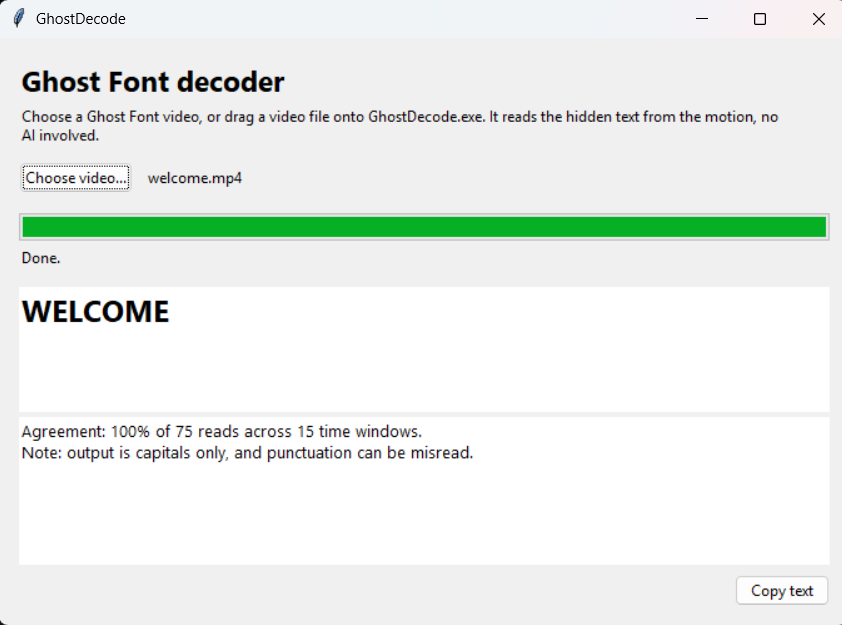

# ghostdecode

Reads the text hidden in [Ghost Font](https://ghostfont.org) videos. Use the
Windows app, the command line, or let an **LLM agent** run the decoder for you.

Ghost Font hides text in motion: dots inside the letters drift one way,
background dots drift the other. A single frame looks like uniform noise, and AI
vision models struggle to read it. ghostdecode reads it from the motion instead.

- **Agent mode:** you ask "what does this video say?", an LLM decides to call the
  decoder as a tool, and reports what it returns. The model never sees the video;
  the tool does the reading, and every tool call is shown. Use a cloud provider
  with your own API key, or a **local model with no key and no internet**.
- **Desktop app and command line:** the decoder itself is classical computer
  vision (optical flow + OCR), so the Decode tab runs offline, for free, with no
  API key.

The site describes Ghost Font as a perception experiment, not encryption, and its
own blog documents a decode via H.264 motion vectors. This project is an
independent take on the same idea, built from optical flow.

## Quick start

**Windows app (nothing to install):** download `GhostDecode-windows.zip` from
the Releases page of this repo, unzip it, and run `GhostDecode.exe`. The
**Decode** tab: press "Choose video..." or drag a video file onto the exe. The
**Ask AI** tab: see below. A decode takes one to a few minutes.

**From Python:**

    pip install -r requirements.txt
    python ghostdecode.py path/to/video.mp4

You also need the [Tesseract OCR engine](https://github.com/tesseract-ocr/tesseract)
installed (on Windows the default install path is detected automatically).

## How it works

1. **Optical flow** (Farneback) between every pair of consecutive frames.
2. **k-means** on the flow vectors splits pixels into motion groups. The
   smaller moving group is the letter dots, giving one mask per frame pair.
3. **Short-window voting.** The text drifts slowly around the screen, so
   summing the whole video blurs it. Masks are summed over short windows
   (20 frame pairs, stride 10) to get sharp heatmaps.
4. **Tesseract OCR** reads each window heatmap with several preprocessing
   variants.
5. **Majority vote** over all reads gives the final text.

## Command line

    python ghostdecode.py video.mp4
    python ghostdecode.py video.mp4 --out ghost_out   # also saves window heatmaps
    python ghostdecode.py video.mp4 --json            # full result as JSON
    python ghostdecode.py video.mp4 --winsize 7       # finer optical-flow window

Output is a per-window readout, the top candidates with agreement percentages,
and a final `DECODED:` line. The agreement figure is the share of OCR reads that
agree; it is a consensus signal, not a probability of being right.

From Python:

    from ghostdecode import decode
    result = decode("video.mp4")
    print(result["text"], result["agreement"])

## Ask AI: an LLM in the driver's seat

The LLM never sees the video and never reads the text itself: it calls the
`decode_ghost_font` tool, the pipeline above does all the reading, and the LLM
reports the result. Every tool call is shown. If the model answers a question
about a video **without** running the decoder, the app flags it, so you know
that answer didn't come from the decoder.

**In the app:** open the **Ask AI** tab, pick a provider, enter your key (or none
for a local model), choose the folder with your videos, press **Connect**, and ask
"what does welcome.mp4 say?".

**From the command line:**

    copy .env.example .env      # then edit .env: provider, model and your API key
    python agent.py

Providers: OpenAI, Anthropic, Gemini, Grok, a local model through Ollama, or any
OpenAI-compatible address. Inside the command-line chat: `/videos` lists videos,
`/folder <path>` switches the video folder, `/quit` exits. The agent can only read
videos inside the chosen folder, and only you can change that folder, not the model.

### Local model (no key, no internet)

1. Install [Ollama](https://ollama.com) and pull a model that supports tool calling
   (`ollama pull <model>`; the Ollama library marks which models support tools).
2. In the app choose **Local model - Ollama**. The address is
   `http://localhost:11434/v1`. Press **Find installed models** and pick one.
3. Choose your video folder and press **Connect**. No key is needed, and no
   request leaves your computer.

Small local models are often unreliable at tool calling. If one answers without
running the decoder, the app warns you; try a larger model.

### How your API key is handled

- The key goes into a masked field, is held **in memory only**, and the field is
  cleared as soon as you connect. **Disconnect** discards it.
- The app **never writes the key to disk**. It remembers only non-secret settings
  (provider, model, address, video folder) in your user profile folder
  (`%APPDATA%\GhostDecode`), never next to the program. A test checks this.
- The app does not read `.env` files. Only the command-line `agent.py` does.
- It's a masked field in a normal desktop program, so be realistic: the key sits
  in the process's memory while connected, and is sent to your chosen provider over
  HTTPS. Use a key with a spending limit.

### What leaves your computer

| | Sent | Never sent |
|---|---|---|
| Cloud provider | your messages, the system prompt, tool results (decoded text, agreement, video file names), and your key as the request's authorization | the video or its frames |
| Local model | nothing | |

Status: the command-line agent was verified live with OpenAI. The **Ask AI tab**,
the Ollama path, and the Anthropic, Gemini and Grok adapters have been tested
against a mock server only, so reports are welcome.

## Desktop app (build it yourself)

With the venv active and Tesseract installed:

    .\build_exe.ps1

The app ends up in `dist\GhostDecode\` with a shareable
`dist\GhostDecode-windows.zip`. The build bundles Tesseract; see
`THIRD_PARTY_NOTICES.md` for licences.

## Synthetic test videos

`tools/make_synthetic.py` builds Ghost-Font-style videos with a known answer,
used to validate the decoder:

    pip install pillow
    python tools/make_synthetic.py "HELLO WORLD" --out samples/hello.mp4
    python ghostdecode.py samples/hello.mp4

Use `|` in the text to force line breaks. Options: `--speed`, `--drift`,
`--frames`, `--width`, `--height`. Defaults are tuned so the decoder reads the
videos reliably (a 36-character message decoded at 100%).

## Tests

    pip install pillow pytest
    pytest -q

## Tested on

Eight videos recorded from ghostfont.org's own generator:

| Video text | Decoded | Reads agreeing |
|---|---|---|
| HELLO HUMAN | HELLO HUMAN | 84% |
| WELCOME | WELCOME | 100% |
| THE QUICK BROWN FOX | THE QUICK BROWN FOX | 99% |
| THE FIVE BOXING WIZARDS JUMP QUICKLY (36 chars) | exact | ~60% |
| Meet me at 9:30, room 4B! | MEET ME AT 9.30, ROOM 4B! | 88% |
| HELLO (invert on) | HELLO | 100% |
| HELLO (slowest speed) | HELLO | 100% |
| HELLO (fastest speed) | HELLO | 100% |

## Known limits

- Output is always uppercase; case isn't recoverable from the heatmap.
- Punctuation can be misread (a colon came out as a period).
- Small text (long messages) needs the finer optical-flow window; the default
  (`--winsize 9`) handled the site's 36-character limit in testing.
- Tested only on videos from ghostfont.org's own generator, at its default
  settings plus invert, slowest and fastest speed.
- Local LLMs can be unreliable at tool calling (see above).

## Project layout

    ghostdecode.py        the decoder (library + command line)
    ghostdecode_app.py    desktop app (Decode tab + Ask AI tab)
    agent.py              LLM tool-calling agent (command line + shared by the app)
    build_exe.ps1         builds the Windows app
    tools/                synthetic video generator
    tests/                tests
    samples/              put generated sample videos here
    docs/                 screenshots

## Credits and licence

Ghost Font is the work of its original creator at ghostfont.org. This project is
independent and not affiliated with it. Please respect their work and don't
redistribute their videos. Released under the MIT licence (see `LICENSE`).
